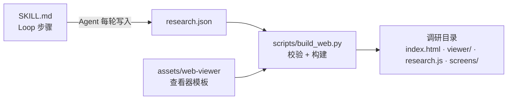

# 架构

术语见 [CONTEXT.md](CONTEXT.md)。

## 整体



- **一个事实来源**：调研的全部内容都在 `research.json`，字段由 `references/data-contract.md` 定义。查看器只读它，不另存状态。
- **查看器是模板**：`build_web.py` 每次构建都把 `index.html` 和 `viewer/` 整体复制到调研目录，调研目录里的这些文件不手动改。`index.html` 里的脚本、样式和 `research.js` 地址都带内容版本号（`?v=`），Loop 进行中刷新页面时，浏览器不会把缓存里的旧脚本和新脚本混用。
- **校验在构建时做**：引用断裂、文件缺失是错误；配额、模式数量等是提醒，也是 Loop 能否结束的判断依据。查看器因此可以信任数据。

## 查看器分层

`index.html` 只有页面结构；逻辑按依赖顺序用普通 `<script>` 加载（不用 ES Module，这样双击 `file://` 也能打开）。每层只依赖它下面的层；运行期的互相调用经由 `main.js` 组装的 `app` 对象。

| 层 | 文件 | 职责 | 性质 |
|---|---|---|---|
| 0 | `util.js` `config.js` `glyph.js` | 工具函数；**全部调参值**；点阵字形 | 纯 |
| 1 | `domain.js` | 调研模型：距离、线索链、关系、关联（不改动原始数据） | 纯 |
| 2 | `layout.js` | 场景几何：模式顺序、岛屿、航道、遮挡、边界、核心、线索点 | 纯 |
| 3 | `camera.js` `stage.js` | 镜头运动；视图节点（位置、明暗、图片）与布局过渡 | 有状态 |
| 4 | `render.js` | 画出一帧，不做交互决策 | 有状态 |
| 5 | `cards.js` `interaction.js` `ui.js` `boot.js` | 面板模板（纯）；交互状态机；界面外壳与面板；任务书开场 | 有状态 |
| 6 | `main.js` `live.js` | 组装、入场与深链接、帧循环；Loop 进行中的实时更新 | 入口 |

几个设计决定：

- **领域数据只读**：渲染状态挂在 `stage` 的视图节点上，不挂在 `research.screens` 上。
- **纯函数可在 Node 里测**：第 0–2 层与 `cards.js` 不碰 DOM，`tools/check_viewer.mjs` 直接加载它们做快照比对。
- **调参只有一处**：时序、阈值、尺寸都在 `config.js`；`DESIGN.md` 解释意图，不重复数值的出处。
- **帧循环先调度下一帧**：单帧出错不会冻住画布；缺失任何一层时，`main.js` 直接在页面上说明缺了哪个文件。
- **交互动词即领域语言**：`wake` / `focus` / `release` / `leave` / `highlight`，与 CONTEXT.md 对应。
- **调研数据可整体替换**：`app.research` 是一份不可变快照，各层用时再取，不在创建时抓进闭包。实时更新时换上新快照，`stage.sync()` 按 id 沿用已有节点，`interaction.remap()` 把唤醒和聚焦换到新对象上。
- **生长中的布局有历史**：完成的调研的布局是数据的纯函数（`islandPositions`）；Loop 进行中的岛屿还取决于上一次的位置，这份历史放在 `stage`（有状态层），`layout` 的 `growIsland` / `settleIsland` 仍是纯函数。完成时回到 `islandPositions`，保证实时看到的最终形态和双击打开时一样。
- **实时更新只在停手时落地**：页面经由 `http://` 打开时，`live.js` 轮询 `research.js`，新数据先排队；用户拖拽、缩放、运镜、入场期间不并入，停手后一次并入。`build_web.py` 先写临时文件再替换，页面不会读到写了一半的数据。

每帧顺序（`main.js`）：镜头推进 → 布局过渡 → 预判聚焦与指针平滑 → 绘制 → 悬停唤醒 → HUD 与深度计 → 并入排队的实时数据。

## 路由表

| 要做的事 | 去哪里 |
|---|---|
| 改 Agent 的调研流程、完成标准 | `mobbin-research/SKILL.md` |
| 加 / 改 `research.json` 字段 | `references/data-contract.md` → `scripts/build_web.py` 的 `check()` → `viewer/domain.js` 或 `cards.js` |
| 改查询词写法 | `references/query-patterns.md` |
| 改 Mobbin 工具对照 | `references/capabilities.md` |
| 改蒸馏、Key Insight、迁移纪律 | `references/synthesis.md` |
| 改颜色、字体、间距、圆角 | `viewer/viewer.css` 的 `:root`，同步 `DESIGN.md` |
| 改时序、阈值、缩放比例、关联限额 | `viewer/config.js`，同步 `DESIGN.md` 的说明 |
| 改关系怎么算、关联怎么选 | `viewer/domain.js` |
| 改岛屿 / 航道的排法 | `viewer/layout.js` |
| 改海面、截图、景深、暗角的画法 | `viewer/render.js` |
| 改唤醒、聚焦、预判、指针与滚轮 | `viewer/interaction.js` |
| 改面板卡片内容、说明提示文案 | `viewer/cards.js` |
| 改 HUD、深度计、工具栏、模式索引、面板开合 | `viewer/ui.js`、`index.html` |
| 加图标 | `viewer/glyph.js` |
| 改入场、Replay、深链接、帧循环 | `viewer/main.js` |
| 改任务书开场的内容与打字、收起 | `viewer/boot.js`，节奏在 `config.js` 的 `boot` |
| 改实时更新的读取与并入时机 | `viewer/live.js`，时序在 `config.js` 的 `live` |
| 改视觉与动效的设计意图 | `assets/web-viewer/DESIGN.md` |
| 更新演示 | `tools/make_demo.py`，再运行 `build_web.py` |
| 压测边界 | `tools/make_stress.py` |
| 模拟 Loop 进行中的实时更新 | `tools/simulate_live.py` |
| 重新录制产品演示（MOV 母版、MP4、README 动图） | `tools/record_demo.cjs`，产物在 `docs/media/`（MOV 不进版本库） |

## 验证

```bash
node tools/check_viewer.mjs
```

先对 `viewer/` 下所有脚本做语法检查，再做纯函数层的快照比对。有意改变布局、关联或卡片内容后，用 `--update` 更新快照，并在提交说明里写明原因。

```bash
python3 mobbin-research/scripts/build_web.py mobbin-research/examples/research-web-demo
```

演示构建应无错误、无提醒。交互改动还需要在浏览器里打开演示，检查：入场下潜；悬停唤醒；点击聚焦；Esc 拉远；滚轮预判聚焦；快速推拉时面板不抖；框选；布局切换；`?frame=` 深链接。边界改动用 `make_stress.py` 的数据再看一遍。实时更新的改动，用模拟脚本边写边看：

```bash
python3 tools/simulate_live.py .live-demo --every 2 --batch 3
python3 -m http.server 4320 --directory .live-demo
```
