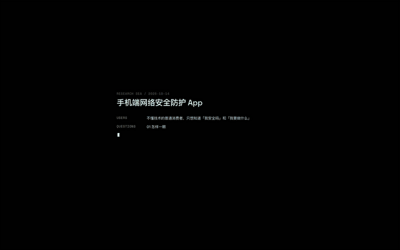

# VT Mobbin Research · 调研之海

让 Agent 用 [Mobbin](https://mobbin.com) 循环调研真实 App 界面，你在旁边看着它把截图、线索和判断织成一片可以游览的海。



[观看完整演示视频（1 分 30 秒）](docs/media/research-sea-demo.mp4)。视频里的截图是用渐变图裁出来的模拟数据。

## 它解决什么问题

设计调研常常停在"收集了一百张截图"：图在文件夹里，判断在脑子里，图与图之间的关系没有留下来。

`vt-mobbin-research` 是一个给 Agent 用的技能（Claude Code、Codex 都能用）。你交给它一个产品方向，它会：

1. **写任务书**：产品、用户、要回答的调研问题、目标数量、四圈配额。
2. **按四圈扩散**：直接竞品 → 间接竞品 → 结构相似 → 表达启发。每保存一张图，都写一句"它对我们有什么启发"，再从这张图长出下一条线索。
3. **织网**：所有截图、线索、呼应和检查点都写进同一个 `research.json`，每一轮都能追溯"这张图是怎么被找到的"。
4. **蒸馏**：模式的共性、分叉与例外，3–7 条可以直接用于设计决策的洞察，精选，以及还没找到好参考的缺口。

交付物不是一份报告，而是一片**调研之海**：一个可以直接双击打开的网页。

## 调研之海里，设计师能做什么

**在 Loop 进行中**

- **看它长出来**：Agent 写完任务书，就在内置浏览器里打开调研之海。任务书先像终端启动一样逐字打出，第一张图到来后进入海面。之后每存一张图，海就长出一张，新图从找到它的那条线索飞来。
- **看 Agent 在想什么**：左上角显示进度，以及 Agent 此刻在追哪条线索；它正在追的线索在海岸线外荡开一圈细环。
- **随时引导**：直接在聊天里说，比如"多看看用温和语气表达状态的产品"。Agent 会把这句话变成线索，下一轮优先去追，回看时这一步会标着 `DESIGNER`。
- **不被打扰**：你在拖拽、缩放或聚焦看图时，新图先排队，停手后才落地。
- **收网**：Loop 结束时，镜头从任何位置拉回全貌，一道光扫过整片海。

**任何时候**

| 操作 | 发生什么 |
|---|---|
| 拖拽 | 在海里漂移 |
| 滚轮 | 下潜或浮起；潜到最深处时，靠近画面中央的那张图会被自动聚焦 |
| 停在一张图上 | 相关的图对上焦，其余的退进景深 |
| 点击一张图 | 镜头推近，右侧面板显示洞察、Agent 的笔记、线索链和关联 |
| `Esc` | 面板收起，镜头往后拉 |
| Shift + 拖拽 | 框选一组图，查看它们的共同点 |
| Insight | 蒸馏结论：洞察、检查点、精选、缺口 |
| Island / Lanes | 关系驱动的点阵圆，或者按模式排成航道 |

在海上，离中心越近，越接近直接竞品；关系越近的图，彼此离得越近。界面上没有连线，也没有"圈层"这样的标签，关系都交给位置去表达。

## 开始使用

**准备**

- [Mobbin 官方 MCP](https://mobbin.com)（`https://api.mobbin.com/mcp`，需要付费计划授权）。社区版 MCP 也能用，工具对照见 [`references/capabilities.md`](vt-mobbin-research/references/capabilities.md)。
- Python 3.9+，用于构建和本地预览。

**安装技能**：把 `vt-mobbin-research/` 复制到 Agent 的技能目录。

```bash
cp -r vt-mobbin-research ~/.claude/skills/
```

```bash
cp -r vt-mobbin-research ~/.codex/skills/
```

**开始一次调研**：

```text
用 vt-mobbin-research 调研手机端网络安全防护 App，收集 100 张界面参考
```

Agent 会先写任务书，再在内置浏览器里打开调研之海，然后开始 Loop。调研结束后，双击调研目录里的 `index.html` 就能再看。

## 先看一眼演示

不需要 Mobbin，就能打开演示：双击 [`examples/research-web-demo/index.html`](vt-mobbin-research/examples/research-web-demo/index.html)。

想看"边调研边生长"的过程，可以用模拟脚本代替 Agent。在两个终端里分别运行：

```bash
python3 tools/simulate_live.py .live-demo --every 2 --batch 3
```

```bash
python3 -m http.server 4320 --directory .live-demo
```

然后打开 <http://localhost:4320>。

## 仓库结构

| 路径 | 内容 |
|---|---|
| [`vt-mobbin-research/`](vt-mobbin-research/) | 技能本体：`SKILL.md`、参考文档、构建脚本、调研之海的查看器、演示数据 |
| [`tools/`](tools/) | 开发工具：演示与压测数据生成、实时模拟、回归检查、演示视频录制 |
| [`CONTEXT.md`](CONTEXT.md) | 领域语言：技能、数据、代码和界面共用的一套词 |
| [`ARCHITECTURE.md`](ARCHITECTURE.md) | 架构、分层、文件路由表、验证方式 |
| [`DESIGN.md`](vt-mobbin-research/assets/web-viewer/DESIGN.md) | 调研之海的视觉、动效与交互设计 |
| [`AGENTS.md`](AGENTS.md) | 给在这个仓库里工作的 Agent 的入口 |

重新录制演示视频（需要全局安装的 Playwright 和 ffmpeg）：

```bash
NODE_PATH=$(npm root -g) node tools/record_demo.cjs
```

## 致谢

- 视觉语言参考 [nullframe](https://github.com/m1ckc3s/nullframe)（Nothing 设计语言）。
- 演示截图由 5 张 [Unsplash](https://unsplash.com) 抽象图裁切而成，来源见[演示说明](vt-mobbin-research/examples/research-web-demo/README.md)。
